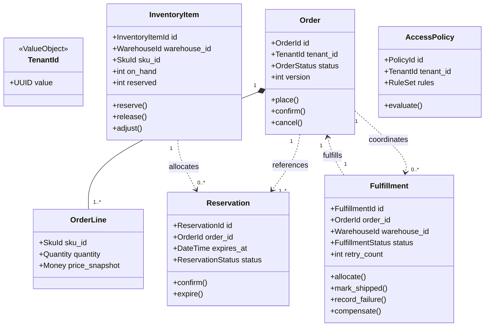

# Domain Model Architecture

## 1. Domain Modeling Principles

The Warehouse platform's domain layer is modeled according to Domain-Driven Design (DDD) principles:

1. **Pure Domain:** The domain layer has zero dependencies on frameworks, databases, or transport mechanisms. It imports no FastAPI, SQLAlchemy, Redis, RabbitMQ, or Elasticsearch symbols.
2. **Aggregate Roots as Consistency Boundaries:** Aggregates encapsulate state transitions, enforce business invariants, and collect domain events.
3. **Explicit Identity & Value Objects:** All entities and aggregates use strongly-typed identifiers (e.g. `TenantId`, `OrderId`, `SkuId`, `FulfillmentId`, `WarehouseId`) and immutable value objects (e.g. `Money`, `Quantity`, `Carrier`, `FulfillmentStatus`).
4. **Optimistic Concurrency & Event Tracking:** Every aggregate root extends `AggregateRoot`, which manages `_version` and an internal collection of `DomainEvent` instances. Any state mutation records a domain event and increments `_version`.

---

## 2. Core Aggregates and Invariants

### 2.1. Ordering Context: `Order`

- **Identifier:** `OrderId` (UUIDv7 or UUIDv4)
- **Entities & Value Objects:** `OrderLine`, `PricingSnapshot`, `OrderStatus`, `CustomerReference`
- **Invariants:**
  - An order must contain at least one line item.
  - Price snapshots are immutable once recorded.
  - Lifecycle state moves forward: `PENDING` -> `RESERVED` -> `CONFIRMED` -> `SHIPPED` -> `COMPLETED`.
  - An order cannot transition backward except through explicit compensating transitions (e.g. `CANCELLED`, `BACKORDERED`).
  - An order can only be confirmed if full inventory reservations cover all required lines.
- **Events Emitted:** `OrderPlaced`, `OrderReserved`, `OrderConfirmed`, `OrderCancelled`, `OrderShipped`, `OrderBackordered`.

### 2.2. Inventory Context: `InventoryItem`, `Warehouse`, `Reservation`

- **Identifiers:** `InventoryItemId`, `WarehouseId`, `ReservationId`
- **Invariants:**
  - Available stock is calculated as: $\text{Available} = \text{On Hand} - \text{Reserved} - \text{Allocated}$.
  - Available stock **cannot fall below zero** under any concurrency scenario.
  - Inventory operations are locked at row level using `SELECT ... FOR UPDATE` ordered deterministically by `id` to prevent deadlocks.
  - Reservations have an explicit expiration timestamp (`expires_at`).
  - Expired or released reservations cannot be confirmed.
- **Events Emitted:** `InventoryAdjusted`, `InventoryReserved`, `InventoryReservationReleased`, `InventoryReservationExpired`, `InventoryAllocated`.

### 2.3. Catalog Context: `Product`, `Sku`

- **Identifiers:** `ProductId`, `SkuId`
- **Invariants:**
  - Product and SKU are distinct aggregates.
  - A Product owns product-level metadata, categories, and descriptive attributes.
  - An SKU belongs to a Product and carries physical inventory characteristics (weight, dimensions, barcode, SKU code).
  - SKU codes are unique per tenant.
- **Events Emitted:** `ProductCreated`, `ProductPublished`, `SkuCreated`, `SkuDiscontinued`.

### 2.4. Fulfillment Context: `Fulfillment`

- **Identifier:** `FulfillmentId`
- **Entities & Value Objects:** `FulfillmentTask`, `Carrier`, `FulfillmentStatus` (`PENDING`, `ALLOCATED`, `IN_PROGRESS`, `SHIPPED`, `FAILED`, `COMPENSATED`), `TaskRequirement`
- **Invariants:**
  - A fulfillment aggregate must contain at least one task.
  - All tasks within a fulfillment must belong to the fulfillment's assigned warehouse.
  - Tasks cannot be marked completed until carrier dispatch occurs.
  - Retry counter tracks external carrier failures up to `max_retries`. When retries are exhausted or a permanent failure is detected, status transitions to `FAILED`.
  - A failed fulfillment can be compensated via `CompensateFulfillment`, releasing reserved inventory.
- **Events Emitted:** `FulfillmentCreated`, `FulfillmentAllocated`, `FulfillmentShipped`, `FulfillmentFailed`, `FulfillmentCompensated`.

### 2.5. Identity & Access Context: `User`, `Role`, `AccessPolicy`

- **Identifiers:** `UserId`, `RoleId`, `PolicyId`, `TenantId`
- **Invariants:**
  - Users are scoped to tenants via `TenantMembership`.
  - Policies define rule sets across subject, resource, action, and environment attributes.
  - Authorization fails closed: if no explicit allow rule matches, access is denied.
  - Operator permissions can be restricted to specific warehouse identifiers.
- **Events Emitted:** `UserRegistered`, `RoleAssigned`, `PolicyCreated`, `AuthorizationEvaluated`.

---

## 3. Aggregate Relationship Diagram

