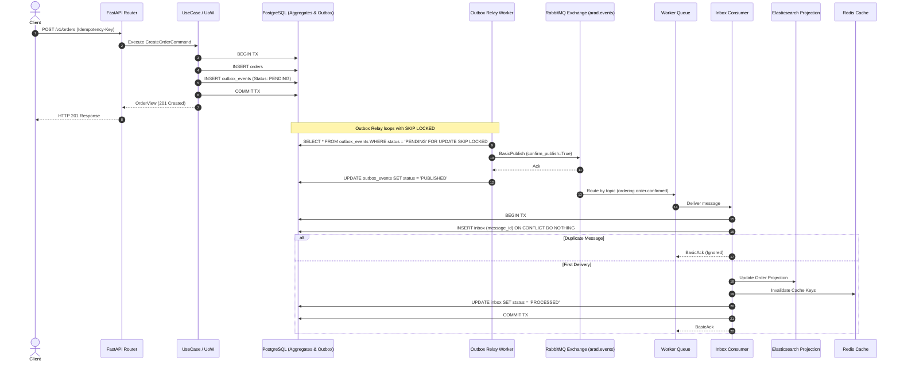

# Event Flow and Asynchronous Messaging Architecture

## 1. Overview of Messaging Topology

The Warehouse platform uses an event-driven architecture combining:
1. **Transactional Outbox Pattern:** Guarantees atomic persistence of aggregate mutations and outgoing domain events in PostgreSQL.
2. **RabbitMQ Topic Exchange (`arad.events`):** Provides durable message delivery with routing keys formatted as `{context}.{entity}.{event_name}`.
3. **Dead-Letter (DLX) & Retry Queues:** Handles temporary consumer failures with exponential backoff and dead-letter queues (`arad.dlx`).
4. **Idempotent Inbox Consumers:** Guarantees at-least-once delivery does not lead to duplicate processing.
5. **Celery Asynchronous Tasks:** Handles background workers, reservation expiration, outbox polling, and scheduled reconciliation.

---

## 2. End-to-End Event Lifecycle



---

## 3. Message Envelope & Headers

Every message published by the outbox relay is wrapped in a standard `OutboxEnvelope`:

```json
{
  "event_id": "018f2d50-7f2e-7cb3-9fa1-cfd128394821",
  "event_type": "ordering.order.confirmed",
  "aggregate_type": "order",
  "aggregate_id": "018f2d50-7f2e-7cb3-9fa1-cfd128394822",
  "tenant_id": "018f2d50-7f2e-7cb3-9fa1-cfd128394823",
  "correlation_id": "req-c189283-99a",
  "causation_id": "018f2d50-7f2e-7cb3-9fa1-cfd128394820",
  "schema_version": 1,
  "occurred_at": "2026-10-14T19:30:00.000000Z",
  "payload": {
    "order_id": "018f2d50-7f2e-7cb3-9fa1-cfd128394822",
    "status": "CONFIRMED",
    "line_count": 2,
    "total_minor": 15000,
    "currency": "USD"
  }
}
```

---

## 4. Error Handling, Retries, and DLQ

- **Broker Failure on Commit:** If RabbitMQ is down when the order commits, the database commit completes successfully. The event remains in `outbox_events` with status `PENDING`. When RabbitMQ recovers, the relay resumes publishing automatically.
- **Consumer Failure:** If a consumer encounters a temporary database connection error:
  1. The message is rejected with `requeue=False` and forwarded to `arad.retry.{queue}` with a TTL.
  2. After TTL expiration, the message is routed back to the main queue for retry.
  3. If retries exceed the retry limit (e.g. 5 attempts), the message is routed to `arad.dlx` for manual inspection and alert generation.
- **Worker Crash:** If a Celery worker crashes mid-task, unacknowledged messages are automatically re-queued by RabbitMQ when the worker connection terminates.
