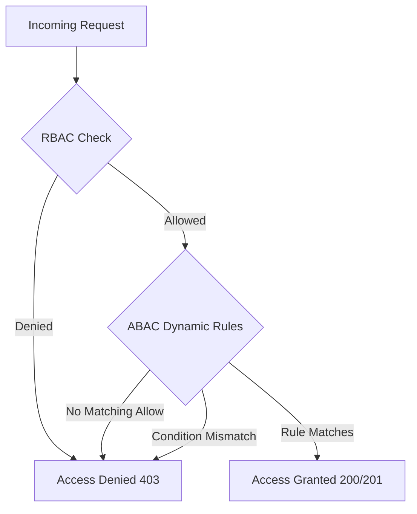

# Security, Authorization, and Multi-Tenancy Architecture

## 1. Multi-Tenancy Architecture

The platform provides strict multi-tenant isolation across all tiers:

1. **Logical Separation in Single Database:** Every table in PostgreSQL carries a `tenant_id: UUID NOT NULL` column.
2. **Context Propagation:** HTTP requests extract tenant context from the authenticated JWT token and `X-Tenant-Id` header. Async messages preserve `tenant_id` in the message envelope.
3. **Defense-in-Depth via PostgreSQL Row-Level Security (RLS):** Even if application SQL fails to include a `WHERE tenant_id = :id` clause, the PostgreSQL engine blocks cross-tenant access because every session sets `app.current_tenant_id`.

---

## 2. Authentication & Principal Hierarchy

- **Password Hashing:** Argon2id with 64MB memory cost, 3 iterations, and 4 degrees of parallelism.
- **Tokens:** Signed RS256 or HS256 JWT bearer tokens with short expiration (1 hour) and tenant claims.
- **Principal Types:**
  - `UserPrincipal`: Human user associated with a tenant and roles.
  - `ServiceAccountPrincipal`: Machine client scoped to specific service permissions and warehouse facilities.
  - `SystemPrincipal`: Internal background worker executing Celery maintenance or scheduled reconciliation.

---

## 3. Authorization: Dual RBAC + ABAC Policy Engine

The authorization system evaluates permissions in two complementary stages:



### 3.1. Dynamic Attribute Evaluation (ABAC)

The ABAC policy engine evaluates:
- **Subject Attributes:** Tenant ID, department, clearance level, assigned warehouse IDs (`assigned_warehouses`).
- **Resource Attributes:** Resource tenant ID, resource warehouse ID (`warehouse_id`), total monetary value, sensitivity level.
- **Action Attributes:** `orders.create`, `inventory.adjust`, `fulfillments.modify`, `search.query`, `audit.read`.
- **Environment Attributes:** Time of request, network origin.

### 3.2. Warehouse-Scoped Access Control

A warehouse operator assigned to warehouse `LAX` cannot execute fulfillment actions for warehouse `SEA`. If an operator attempts to access another warehouse's resource, the policy engine rejects the request with an explicit reason:
`"Subject assigned_warehouses do not include target warehouse_id"`.

---

## 4. PostgreSQL Row-Level Security (RLS) Configuration

All tenant tables have RLS enabled:

```sql
ALTER TABLE orders ENABLE ROW LEVEL SECURITY;
ALTER TABLE orders FORCE ROW LEVEL SECURITY;

CREATE POLICY tenant_isolation_orders ON orders
    AS RESTRICTIVE
    USING (tenant_id = current_setting('app.current_tenant_id', true)::uuid)
    WITH CHECK (tenant_id = current_setting('app.current_tenant_id', true)::uuid);
```

Before executing queries, the application sets the session variable:
`SET LOCAL app.current_tenant_id = '<tenant_id>';`
If no tenant is configured, queries return 0 rows.
