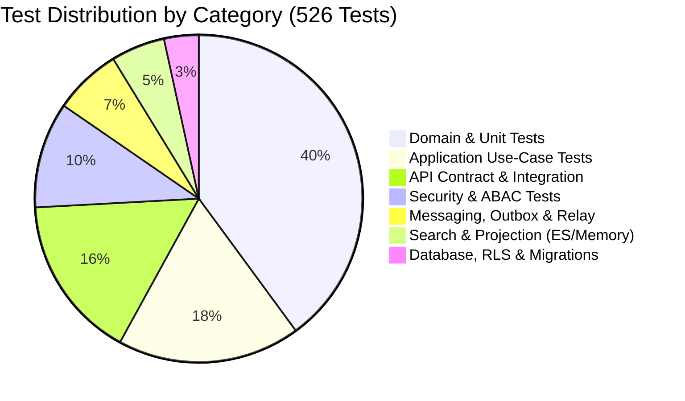

# Testing Strategy and Quality Assurance

## 1. Testing Philosophy

The platform's testing strategy follows the test pyramid:
- High volume of fast, pure unit tests with zero I/O.
- Application use-case tests with in-memory fakes.
- Real integration tests validating true external contracts with PostgreSQL, Redis, RabbitMQ, and Elasticsearch running via Docker containers.
- Concurrency and property-based tests verifying domain invariants under stress.
- BDD / E2E acceptance tests verifying business journeys.

---

## 2. Test Classification and Distribution

The test suite consists of **526 automated tests**:

---

## 3. Key Test Categories

### 3.1. Fast Pure Unit Tests (`tests/unit/`)
- Tests aggregates, entities, and value objects (`Order`, `InventoryItem`, `Fulfillment`, `AccessPolicy`, `Money`, `Quantity`).
- Zero network, zero disk, runs in milliseconds.
- Tests domain invariants: negative stock prevention, invalid state transition rejections, and event recording.

### 3.2. Concurrency Tests (`tests/concurrency/`)
- Validates that concurrent attempts to reserve the last unit of stock across 10-20 parallel asyncio tasks result in exactly 1 successful reservation and 0 negative stock.

### 3.3. Failure Injection Tests (`tests/integration/test_failure_injection.py`)
- Injects network breaks and outages to verify graceful degradation:
  - Cache failure -> transparent PostgreSQL fallback.
  - RabbitMQ outage -> aggregate commits safely, outbox buffers events.
  - Elasticsearch downtime -> transactional operations remain unimpaired.

### 3.4. BDD Acceptance Scenarios (`tests/integration/test_order_search_bdd.py`, etc.)
- Executable Gherkin-aligned scenarios verifying:
  1. Concurrent last-unit reservation.
  2. Idempotent order submission.
  3. Outbox delivery across broker restarts.
  4. Warehouse-scoped ABAC operator enforcement.
  5. Eventually consistent search projection updates.
